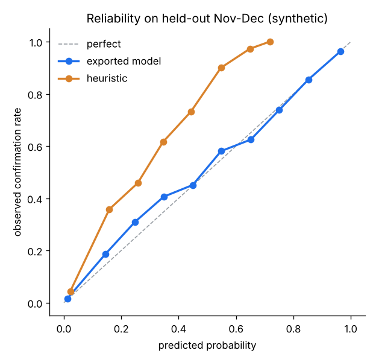

# WL model evaluation (synthetic data)

> Every number here is measured on **simulated** bookings (`analytics/railops_ml/simulate.py`). It shows the pipeline works and how the methods compare **on the simulator's mechanics**. It says nothing about accuracy for real passengers.

Split by run date: train Jan–Aug (96,075 WL bookings), validation Sep–Oct (24,696), test Nov–Dec (24,301). Test base rate 21.6%.

## Held-out test (Nov–Dec)

| Model | AUC | Log-loss | Brier | ECE |
|---|---|---|---|---|
| Counter-clerk heuristic (WL ≤ ~20% of capacity clears) | 0.917 | 0.3175 | 0.0970 | 0.0902 |
| Logistic (hinge WL basis), uncalibrated — **exported** | 0.963 | 0.2000 | 0.0627 | 0.0106 |
| Logistic + isotonic fitted on Sep–Oct | 0.963 | 0.2048 | 0.0634 | 0.0202 |
| HistGradientBoosting + isotonic (challenger) | 0.962 | 0.2051 | 0.0639 | 0.0175 |

Leaky protocol for comparison (random 80/20 split, per-train priors computed on all rows): AUC 0.967, log-loss 0.1880. That looks ~6% better than the honest number: the size of the error a random split would have hidden.

## Decisions the evaluation forced

1. **No isotonic calibration.** Fitted on Sep–Oct (Dussehra/Diwali), it pulled probabilities down and *worsened* Nov–Dec calibration (ECE 0.011 → 0.020). The choice is now made by a one-step-earlier backtest (fit Jan–Jun, calibrate Jul–Aug, score Sep–Oct): isotonic log-loss 0.1892 vs raw 0.1887 → **identity**.
2. **Hinge basis, not a quadratic.** The first version used `wl_ratio²`; the monotonicity gate rejected it because the fitted parabola turned upward near WL ≈ 0.94 × capacity (a *worse* position would have scored higher). Piecewise-linear segments have no vertex. Segment slopes of the logit: from 0: -29.1578, from 0.1: -17.7195, from 0.25: -10.3753, from 0.5: -10.3532.
3. **Logistic, not GBDT.** export logistic+identity (GBDT log-loss gain -0.0051 <= 0.01). A tree ensemble would be harder to keep in Java parity and to explain to staff, for no measurable gain.

## Reliability (test)

| Bin | n | Predicted | Observed |
|---|---|---|---|
| 0.0-0.1 | 15,901 | 0.012 | 0.016 |
| 0.1-0.2 | 1,567 | 0.145 | 0.186 |
| 0.2-0.3 | 863 | 0.248 | 0.309 |
| 0.3-0.4 | 670 | 0.348 | 0.406 |
| 0.4-0.5 | 601 | 0.449 | 0.451 |
| 0.5-0.6 | 539 | 0.548 | 0.581 |
| 0.6-0.7 | 549 | 0.651 | 0.625 |
| 0.7-0.8 | 619 | 0.750 | 0.738 |
| 0.8-0.9 | 807 | 0.852 | 0.855 |
| 0.9-1.0 | 2,185 | 0.963 | 0.963 |

Mild under-prediction from 0.1 to 0.4 (observed runs 4–6 points higher). That's the safe direction for a passenger deciding whether to keep a WL ticket, and it's what the `calibration_gap` gauge watches on real traffic.

## Slices (test)

| Slice | n | Base rate | AUC | Brier | ECE |
|---|---|---|---|---|---|
| wl_ratio<0.15 | 2,985 | 0.898 | 0.8365 | 0.0773 | 0.0118 |
| wl_ratio 0.15-0.4 | 6,327 | 0.366 | 0.8095 | 0.1691 | 0.0306 |
| wl_ratio>=0.4 | 14,989 | 0.017 | 0.9309 | 0.0149 | 0.0033 |
| festival | 11,553 | 0.150 | 0.9609 | 0.0573 | 0.022 |
| days_before<7 | 5,571 | 0.036 | 0.9881 | 0.0133 | 0.0074 |
| days_before>=45 | 2,526 | 0.453 | 0.9308 | 0.1073 | 0.0223 |
| class 3A | 11,395 | 0.216 | 0.9601 | 0.0656 | 0.0161 |
| class SL | 12,906 | 0.217 | 0.9655 | 0.0602 | 0.0075 |

The hard band is WL 15–40% of capacity (Brier ≈ 0.17): that's where the outcome really depends on future cancellations. Below or above that band, position alone mostly decides.

Reproduce: `scripts/ml-train.sh` (≈10 s). Full metrics: `analytics/out/evaluation.json`.
